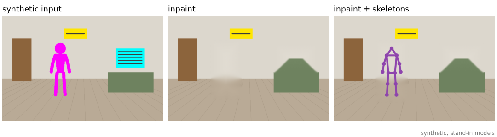
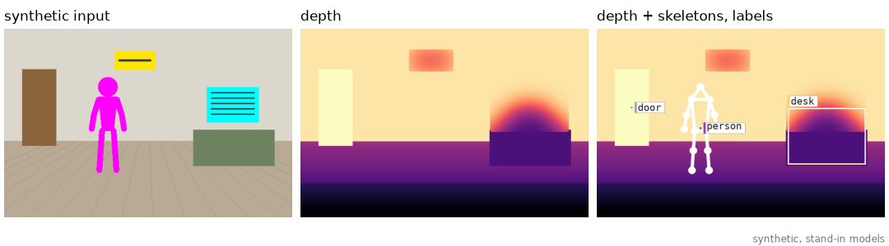
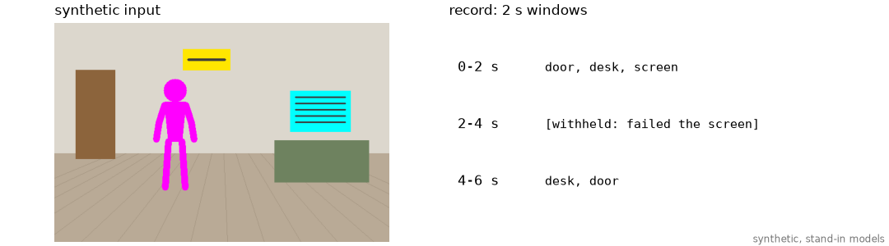

# egoanon

Local anonymisation of head-mounted (egocentric) video.

- **Detection:** faces, the head and badge band of every detected person, and screens.
- **Tracking:** links detections and fills short dropouts. It only ever adds cover.
- **Render levels:** eight, from blur to a text-only record (table below).
- **Fails closed:** missing models, detector errors, unscanned frames or a changed source stop the run.


## Levels

| Level | Output | What is left of the scene | Needs, beyond the plan |
|---|---|---|---|
| `blur` | video | everything, with regions blurred | nothing |
| `pixelate` | video | everything, with regions as a blurred mosaic | nothing |
| `block` | video | everything, with regions black | nothing |
| `inpaint` | video | the room: people and screens are replaced by invented pixels. Optional skeletons | LaMa; YOLO pose for skeletons |
| `depth` | video | relative depth of the people-free frame, with screens and signs blurred. Optional labels and skeletons | LaMa, Depth Anything V2, CLIPSeg |
| `silhouette` | video | filled region shapes, no source pixels | nothing |
| `boxes` | video | region outlines, no source pixels | nothing |
| `record` | JSON | one line of listed object words per window, no image. **May be wrong** | a local vision-language model |

`inpaint` and `depth` need a plan made with `scan --bodies`, which finds whole people, not just heads and badges. Both refuse a plan without it.

These three demos are synthetic and use stand-in models, so they don't show how good the real models are:





## Install

Python 3.12 (the pinned MediaPipe does not support newer versions).

```sh
python -m venv .venv && source .venv/bin/activate
pip install -r requirements.txt
```

## Quick example

The demo makes its own clip of coloured shapes and needs no model:

```sh
python -m egoanon.demo
python -m egoanon.demo_scene inpaint   # or: depth, record
```

For real video, first download `yolo11m.pt` from [Ultralytics](https://docs.ultralytics.com/models/yolo11/). Egoanon never downloads models itself.

```sh
python -m egoanon scan input.mp4 --weights yolo11m.pt --plan plan.json
python -m egoanon render input.mp4 output.mp4 --plan plan.json --level blur
```

## Model levels

Egoanon never downloads models. Get them once, on a connection you are happy to use, then pass local paths.

| Model | Used by | Get |
|---|---|---|
| LaMa, `big-lama.pt` | inpaint, depth | [simple-lama-inpainting release](https://github.com/enesmsahin/simple-lama-inpainting/releases/tag/v0.1.0) |
| YOLO pose, `yolo11m-pose.pt` | optional skeletons | [Ultralytics](https://docs.ultralytics.com/tasks/pose/) |
| Depth Anything V2 **Small** | depth | [depth-anything/Depth-Anything-V2-Small-hf](https://huggingface.co/depth-anything/Depth-Anything-V2-Small-hf) |
| CLIPSeg | depth: screens, signs, labels | [CIDAS/clipseg-rd64-refined](https://huggingface.co/CIDAS/clipseg-rd64-refined) |
| Qwen2-VL 7B, 4-bit MLX | record | [mlx-community/Qwen2-VL-7B-Instruct-4bit](https://huggingface.co/mlx-community/Qwen2-VL-7B-Instruct-4bit) |

```sh
pip install -r requirements-scene.txt
pip install --no-deps simple-lama-inpainting==0.1.2

python -m egoanon scan input.mp4 --weights yolo11m.pt --bodies --plan plan.json
python -m egoanon render input.mp4 inpaint.mp4 --plan plan.json --level inpaint \
    --lama big-lama.pt --pose yolo11m-pose.pt
python -m egoanon render input.mp4 depth.mp4 --plan plan.json --level depth \
    --lama big-lama.pt --depth-model models/depth-small --clipseg models/clipseg --labels
```

Without `--pose` there are no skeletons, and without `--labels` no object labels. Labels come from a fixed word list.

### Record: an optional extra, offline only

The language model sees **original frames, people and screens included**. Run it only on the machine that holds the video, never against a hosted API, and disconnect it from the network for sensitive material. The adapter needs Apple silicon and its own environment, because mlx-vlm and the other levels need different OpenCV and transformers versions.

```sh
python -m venv .venv-record && source .venv-record/bin/activate
pip install -r requirements-record.txt
python -m egoanon render input.mp4 record.json --plan plan.json --level record \
    --vlm models/qwen2-vl --window 10
```

The middle frame of each window is described. A line is kept only if all of this holds:

- every word, capitalised or not, is on the [object-word list](egoanon/screen.py);
- there are 2 to 6 words, in ASCII, separated by a space or by a comma and a space (`desk,door` is rejected);
- there are no digits or spelled-out numbers, and only the first word may start with a capital.

After 12 failed tries the window is withheld. Expect that often, as the list is short. Rejected text is never saved or printed.

> **The model can hallucinate.** It can name objects that are not present, and every one of them can be on the list. The screen limits what can be said, not whether it is true. A person must check every line against the video before it is used or shared.

While the three model levels run, Hugging Face and Ultralytics are set offline and Python network connections are refused. Native code could bypass that, which is why disconnecting is the safe choice.

## Limits

**This does not guarantee anonymity. A person must review every output.** Detectors miss faces, and do not look for tattoos, wristbands, documents or whiteboards. Add `ManualRegion`s to the plan for those. Blur and pixelation can sometimes be reversed, so use `block` or stronger when in doubt.

- **Inpaint:** whoever the detectors miss stays visible, for example someone under a blanket, so add a `ManualRegion`. Signs, documents and whiteboards stay readable. The fill is invented and flickers between frames, so don't analyse it as scene content.
- **Depth:** shapes can still identify a place or a person the detectors missed. Values are relative to each frame, not distances.
- **Skeletons:** posture and gait can identify people. Leave them off if that matters.
- **Record:** output can include objects that are not present (hallucination) and must be checked. Listed words can still reveal something about a place, and a name spelled like an object word would pass. A line says nothing about the frames between the sampled ones.

Audio is dropped. The plan holds box positions and should be kept with the raw video.

## Licence and credit

This code is MIT, see [LICENSE](LICENSE). The detector it uses, Ultralytics YOLO, and its weights are **AGPL-3.0**, which may apply to what you build with them. That includes the pose weights.

The optional models are not included and keep their own licences:

- **LaMa** ([advimman/lama](https://github.com/advimman/lama)): Apache-2.0, as is simple-lama-inpainting. The weights were trained on Places2, which has its own terms.
- **Depth Anything V2** ([DepthAnything/Depth-Anything-V2](https://github.com/DepthAnything/Depth-Anything-V2)): the code and **Small** weights are Apache-2.0. The **Base, Large and Giant weights are CC-BY-NC-4.0**, non-commercial.
- **CLIPSeg** ([timojl/clipseg](https://github.com/timojl/clipseg)): MIT code, whose licence excludes the weights. The Hugging Face card gives the weights as Apache-2.0.
- **Qwen2-VL 7B:** Apache-2.0. **mlx-vlm:** MIT.

Developed by the Cambridge Cognitive Architecture Lab.
