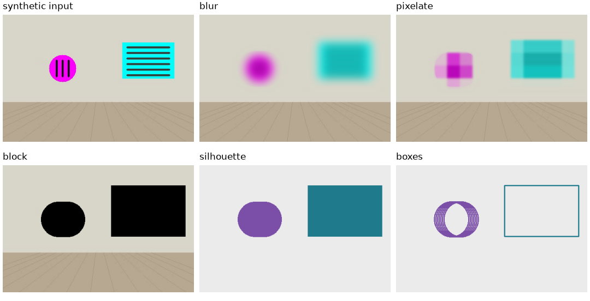

# egoanon

Local anonymisation of head-mounted (egocentric) video.

- **Detection:** faces, the head and badge band of every detected person, and screens.
- **Tracking:** links detections and fills short dropouts. It only ever adds cover.
- **Render levels:** `blur`, `pixelate`, `block`, and two that keep no source pixels, `silhouette` and `boxes`.
- **Fails closed:** missing models, detector errors, unscanned frames or a changed source stop the run.



## Install

Python 3.12 (the pinned MediaPipe does not support newer versions).

```sh
python -m venv .venv && source .venv/bin/activate
pip install -r requirements.txt
```

## Quick example

The demo makes its own clip of coloured shapes and needs no model:

```sh
python -m egoanon.demo
```

For real video, first download `yolo11m.pt` from [Ultralytics](https://docs.ultralytics.com/models/yolo11/). Egoanon never downloads models itself.

```sh
python -m egoanon scan input.mp4 --weights yolo11m.pt --plan plan.json
python -m egoanon render input.mp4 output.mp4 --plan plan.json --level blur
```

## Limits

**This does not guarantee anonymity. A person must review every output.** Detectors miss faces, and do not look for tattoos, wristbands, documents or whiteboards. Add `ManualRegion`s to the plan for those. Blur and pixelation can sometimes be reversed, so use `block` or stronger when in doubt. Audio is dropped. The plan holds box positions and should be kept with the raw video.

## Licence and credit

This code is MIT, see [LICENSE](LICENSE). The detector it uses, Ultralytics YOLO, and its weights are **AGPL-3.0**, which may apply to what you build with them.

Developed by the Cambridge Cognitive Architecture Lab.
